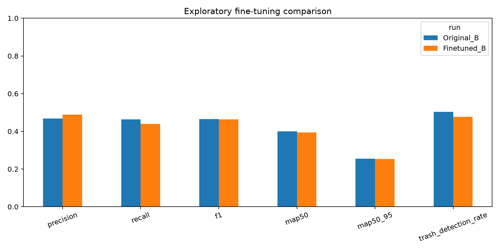

# 공식 TrashCan 추가 미세조정 결과

2026-10-24(KST) 추가 50 epoch 학습, 동일 테스트 평가, 전후 비교와 가중치 검증을 완료했습니다. **Precision은 상승했지만 Recall·F1·mAP·쓰레기 Recall은 하락해 전반적인 성능 개선은 확인되지 않았습니다.** 기본 config.yaml의 A/B 가중치를 교체하지 않았습니다.

## 조건과 데이터

- 기존 B의 검증 최적 best.pt에서 새 AdamW 옵티마이저로 추가 50 epoch를 학습했습니다. 원본 A/B는 보존했습니다.
- 공식 TrashCan Instance 7,212장의 기존 영상 그룹 분할을 유지했습니다: train 4,918장, val 1,159장, test 1,135장. 새 촬영 정답 라벨은 0장입니다.
- 입력 640, batch 8, lr0 0.0001, mosaic 0.5, seed 42, CPU입니다. B의 학습용 수중 증강(strength 0.5, probability 0.8)을 유지했고 val/test는 원본입니다.
- best.pt는 검증 결과로 선정했습니다. 테스트는 conf 0.25, 일대일 클래스 일치 IoU 0.5의 micro P/R/F1, AP cutoff 0.001의 Ultralytics mAP50/mAP50-95를 사용했습니다.
- 평가 서명과 테스트 해시가 기존 B와 일치하며 test의 정답 객체 수는 2,089개(Trash 832, Marine_Life 588, Equipment 669)입니다.

## 동일 테스트 결과

| 지표 | 기존 B | 추가 학습 B | 변화(%p) |
|---|---:|---:|---:|
| Precision | 46.87% | 48.94% | +2.06 |
| Recall | 46.29% | 44.04% | -2.25 |
| F1 | 46.58% | 46.36% | -0.22 |
| mAP50 | 39.96% | 39.40% | -0.56 |
| mAP50-95 | 25.45% | 25.34% | -0.11 |
| Trash Recall | 50.36% | 47.72% | -2.64 |



## 클래스별 결과

| 클래스 | 기존 Precision | 추가 Precision | 기존 Recall | 추가 Recall | 기존 mAP50 | 추가 mAP50 |
|---|---:|---:|---:|---:|---:|---:|
| Trash | 40.72% | 41.05% | 50.36% | 47.72% | 31.15% | 29.58% |
| Marine_Life | 34.75% | 36.96% | 16.67% | 16.16% | 18.52% | 17.25% |
| Equipment | 59.84% | 65.24% | 67.26% | 63.98% | 70.22% | 71.38% |

## 오류 진단

| 클래스 무관 IoU 매칭 진단 | 기존 B | 추가 학습 B |
|---|---:|---:|
| 매칭 예측이 없는 Trash | 384 | 413 |
| Marine_Life → Trash | 133 | 137 |
| Trash → Marine_Life | 38 | 20 |
| 정답과 매칭되지 않은 Trash 예측 | 476 | 420 |

위 오류 진단은 오분류를 드러내기 위한 클래스 무관 매칭이고, P/R/F1 및 클래스별 FN은 클래스 일치 매칭이어서 수치가 다를 수 있습니다. 매칭되지 않은 예측에는 중복 탐지나 정답 누락도 포함될 수 있습니다.

## 해석과 한계

- 추가 학습은 오탐 일부를 줄였지만 쓰레기 미탐과 해양 생물→쓰레기 오분류를 개선하지 못했습니다. 모델을 더 오래 학습하는 것만으로 실제 수중 웹캠 성능이 개선됐다고 주장할 수 없습니다.
- 기존 B와 초기 가중치·누적 학습량·학습률·mosaic 설정이 다른 탐색적 비교입니다. 단일 seed 결과이며 같은 test를 다시 평가했으므로 독립적인 통계적 유의성이나 새로운 촬영 환경의 성능을 입증하지 않습니다.
- experiment.json에 체크포인트 재개 7회가 기록됐고 최초 실패 및 복구 자료는 results/recoveries에 보존했습니다. 완료된 epoch는 1~50으로 연속임을 확인했습니다. 중단된 epoch의 일부 배치는 다시 처리돼 비트 단위 재현이나 정확한 총 업데이트 횟수의 동일성을 보장하지 않습니다. results.csv의 time은 재개 시 초기화되므로 마지막 행으로 총 소요 시간을 계산하지 않습니다.
- 실제 촬영 영상의 정답 바운딩 박스가 제공되지 않아 실제 웹캠 Precision/Recall/mAP는 평가하지 않았습니다. 새 촬영 데이터의 검토·수동 라벨링과 영상 단위 독립 분할이 후속 단계입니다.
- 순수 추론 FPS는 기존 B 14.44, 추가 B 11.11로 관측됐습니다. 측정 시각·CPU 부하가 달라 속도의 직접적인 개선/악화 근거로 사용할 수 없으며 실제 웹캠 FPS가 아닙니다.

## 파일과 선택적 실행

- 가중치: [models/B_finetune_seed42/weights/best.pt](models/B_finetune_seed42/weights/best.pt)
- [전후 비교 CSV](results/finetune_comparison/comparison.csv), [클래스별 CSV](results/finetune_comparison/class_comparison.csv), [평가 원기록](results/evaluation/B_finetune_seed42/evaluation.json)
- [학습 기록](models/B_finetune_seed42/experiment.json), [50 epoch 학습 CSV](models/B_finetune_seed42/results.csv), [검증 기록](results/finetune_verification.json)

추가 모델을 직접 확인하려면 다음 명령을 사용합니다. 기본 모델 선택은 유지했으며 추가 모델을 더 우수한 모델로 간주하지 않습니다.

```powershell
.\start_webcam.cmd --config config.finetune.yaml --variant B --camera 0 --conf 0.25
```

최종 가중치 SHA256: `069be513b5536e698712323799b96dbd6734c9145dd0dd483649dcea13e0b418`
데이터 fingerprint: `163cbd3f1f99f58a9c49654aa74fd8ac9d96a0c1609e2ceb038e6b75be1a423e`
