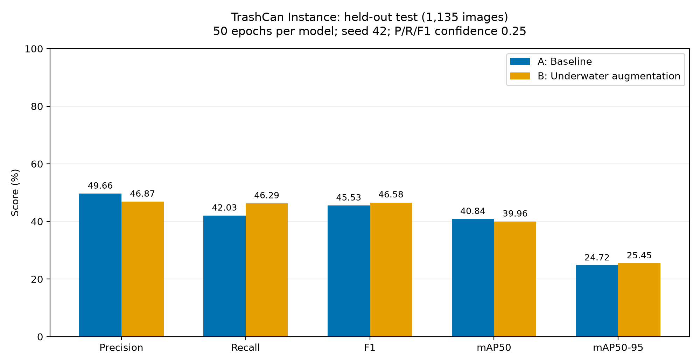

# 공식 TrashCan 기반 YOLO26n 학습·성능 비교 결과

완료 시각: 2026-10-18 13:20 KST. 실제 학습/평가 파일에서 작성했으며 임의 성능 수치를 사용하지 않았습니다.

## 연구 조건

- 공식 TrashCan 1.0의 Instance 버전 7,212장을 사용했습니다. Material 버전은 함께 사용하지 않았습니다.
- 원본 train/val 간 영상 ID가 113개 겹쳐 영상 단위로 재분할했습니다. train 4,918장(218개 영상), val 1,159장(47개), test 1,135장(47개)이며 영상 ID 교집합은 0입니다.
- 원본 bbox의 1픽셀 미만 경계 초과 3,286개를 보정하고 동일 클래스·동일 bbox의 중복 정답 한 개를 제거했습니다. 원본은 보존했으며 보정·중복 내역 CSV가 있습니다.
- 클래스는 Trash, Marine_Life, Equipment입니다. 테스트 정답은 총 2,089개(Trash 832, Marine_Life 588, Equipment 669)입니다.
- A/B 모두 같은 사전학습 YOLO26n, 50 epoch, 입력 640, batch 8, AdamW, lr0 0.001, seed 42, CPU를 사용했습니다. 각 모델을 50 epoch 학습한 후 검증 데이터로 선택한 best.pt를 독립 test에 평가했습니다.
- 공통 HSV/좌우 반전/mosaic 등은 config.yaml과 모델별 args.yaml에 기록했습니다. B에만 밝기·대비·청색/녹색 색조·블러·노이즈를 strength 0.5/probability 0.8로 학습 이미지에 1:1 추가 적용했습니다. 검증·테스트는 원본입니다.
- P/R/F1은 conf 0.25, 클래스 일치 일대일 IoU 0.5 매칭의 micro 값입니다. mAP는 AP cutoff 0.001과 IoU 0.50:0.95의 Ultralytics 표준 평가이며 3개 클래스 평균입니다.
- 학습/평가 조건 서명과 테스트 해시가 A/B에서 일치하며, 최종 가중치 SHA256도 학습·평가 기록과 일치하는 것을 검증했습니다.

## 전체 테스트 결과

| 지표 | A 기본 | B 수중 증강 | B−A |
|---|---:|---:|---:|
| Precision | 49.66% | 46.87% | -2.79 %p |
| Recall | 42.03% | 46.29% | +4.26 %p |
| F1 | 45.53% | 46.58% | +1.05 %p |
| mAP50 | 40.84% | 39.96% | -0.88 %p |
| mAP50-95 | 24.72% | 25.45% | +0.73 %p |



## 클래스별 테스트 결과

| 클래스 | A Precision | B Precision | A Recall | B Recall | A mAP50 | B mAP50 |
|---|---:|---:|---:|---:|---:|---:|
| Trash | 43.18% | 40.72% | 49.88% | 50.36% | 38.26% | 31.15% |
| Marine_Life | 57.31% | 34.75% | 16.67% | 16.67% | 20.23% | 18.52% |
| Equipment | 57.39% | 59.84% | 54.56% | 67.26% | 64.04% | 70.22% |

## 오류 분석

| 오류 유형(클래스 무관 IoU 매칭) | A | B |
|---|---:|---:|
| 정답 Trash에 매칭 예측 없음 | 389 | 384 |
| 해양 생물 → Trash | 122 | 133 |
| Trash → 해양 생물 | 28 | 38 |
| 정답과 매칭되지 않은 Trash 예측 | 416 | 476 |

오류 진단용 혼동행렬은 클래스 무관 IoU 매칭, 표의 P/R/F1은 클래스 일치 매칭이므로 TP 집계가 서로 다를 수 있습니다. 매칭되지 않은 예측은 배경뿐 아니라 중복 탐지·정답 라벨 누락 등을 포함할 수 있습니다. 전체 객체 FN은 per_class.csv를 확인하세요. 각 모델의 error_images 폴더에 오류가 발생한 이미지 최대 40개(저장 순서 기준)를 저장했습니다.

## FPS와 해석

| 측정값 | A | B |
|---|---:|---:|
| 순수 추론 FPS | 26.09 | 14.44 |
| 이미지 처리·매칭 등을 포함한 pipeline FPS | 22.38 | 12.06 |

워밍업을 제외한 이번 CPU 실행 관측값이며 웹캠 실시간 FPS가 아닙니다. A/B는 다른 시각에 측정되어 부하·전원·발열 상태가 다를 수 있습니다. 동일 구조의 모델이므로 증강 자체가 추론 속도를 바꿨다고 단정할 수 없고, 속도 비교에는 같은 상태에서 교대로 반복 측정하는 실험이 추가로 필요합니다.

## 결론과 한계

B는 전체 Recall/F1/mAP50-95가 소폭 높았지만 Precision/mAP50은 낮았습니다. 전체 TP는 A 878개에서 B 967개로 89개 늘었으며, 그중 85개는 보조 클래스 Equipment의 증가입니다. 핵심 Trash의 mAP50은 하락했고 Marine_Life Recall은 두 모델 모두 16.67%였습니다. 따라서 이번 결과로 수중 증강이 해양 쓰레기·생물 구분을 전반적으로 개선했다고 결론 내릴 수 없습니다.
실험은 seed 42 한 쌍이며 통계적 유의성이나 다른 환경으로의 일반화를 입증하지 않습니다. A/B 모두 절전·프로세스 종료 이후 체크포인트에서 재개한 이력이 있고, 서로 다른 중단 이력 때문에 난수 진행이 비트 단위로 같다고 보장하지 않습니다. 자세한 복구 기록과 원본 체크포인트는 OFFICIAL_TRAINING.md, experiment.json의 resumptions, results/recoveries에 보존했습니다.
실제 수조의 조명·탁도·혼합 조건 영상과 수동 정답은 제공되지 않아 해당 조건의 정량 성능은 측정하지 않았습니다. 실제 웹캠/로봇 적용 성능도 검증하지 않았습니다. 탐지 신뢰도가 낮거나 탐지가 없다는 이유로 실제 객체가 없다고 확정하면 안 됩니다.
추가 실험을 설계한다면 검증 데이터에서 생물·쓰레기의 라벨과 미탐 사례를 먼저 검토하고, 사전에 정한 조건과 여러 seed로 재확인해야 합니다. 이번 테스트 결과를 보고 임계값이나 증강 조건을 조정한 뒤 같은 테스트를 독립 성능으로 재사용하면 안 됩니다.

## 파일과 실행

- 학습 모델: models/A_seed42/weights/best.pt, models/B_seed42/weights/best.pt
- 비교 표/그림: results/comparison/comparison.csv, class_comparison.csv, overview.png 및 지표별 PNG
- 클래스별 평가/혼동행렬/예측/오류/시간: results/evaluation/A_seed42 및 B_seed42
- 실제 학습 곡선: results/comparison/A_seed42_loss.png, A_seed42_validation.png, B_seed42_loss.png, B_seed42_validation.png
- 데이터 출처/라벨 변환/학습 이력: OFFICIAL_TRAINING.md 및 data/raw/trashcan_1_0/provenance.json
- 상세 사용법: README.md

프로젝트 폴더에서 대시보드를 실행한 뒤 A/B 모델을 선택할 수 있습니다.

```powershell
../.venv/Scripts/python.exe -m streamlit run app.py
```

공식 출처: [IRV TrashCan 안내](https://irvlab.cs.umn.edu/resources/trashcan), [원본 데이터 DOI](https://doi.org/10.13020/g1gx-y834). Hong, Jungseok; Fulton, Michael S; Sattar, Junaed 및 JAMSTEC을 보고서에 표기하세요. LICENSE.txt 원문은 원본 데이터 폴더에 보존했습니다.
